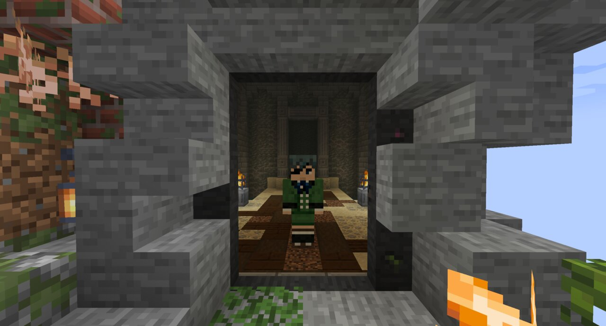
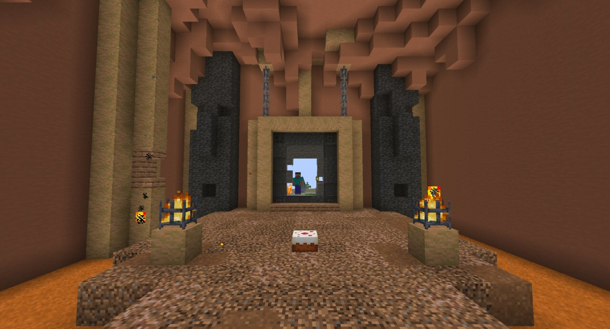
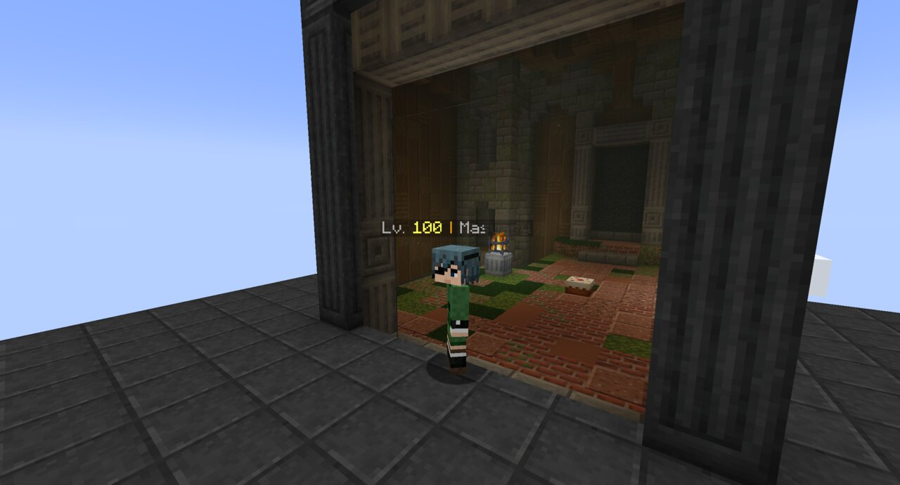

# Immersive Portals for Vault Hunters

See-through vault portals for **Vault Hunters 3** on Minecraft 1.18.2 (Forge). Light a portal frame in the hub and you
see the vault's start room through it straight away, walk in without a loading screen, and see the hub again through
the start-room portal on the way out. Every crossing still goes through Vault Hunters' own rules.



[CurseForge](https://www.curseforge.com/projects/1787636) |
[Wiki](https://github.com/Masuary/ImmersivePortalsModForForge/wiki) |
[Discord](https://discord.gg/z559pXRM8M) |
[Report a bug](https://github.com/Masuary/ImmersivePortalsModForForge/issues) |
[Changelog](CHANGELOG.md)

This is an unofficial fork of [Immersive Portals for Forge](https://github.com/iPortalTeam/ImmersivePortalsModForForge)
(1.18 branch, version 1.4.20). Immersive Portals is made by [qouteall](https://github.com/qouteall) and kept alive on
Forge by [Nick1st](https://github.com/Nick1st). This fork is not made or supported by them: please report problems with
it here or on our Discord, not to the original authors.

## Supported packs

| Pack | Version |
|---|---|
| Vault Hunters 3rd Edition - Remastered | 3.0.1 |
| Vault Hunters 3rd Edition | 3.21.7 |
| Wold's Vaults | 0.34.2 |

Minecraft 1.18.2, Forge 40.2 or newer, on servers and in singleplayer. Works with Oculus shader packs.

## What it does

- **Vault windows.** A lit hub frame shows its vault before anyone enters, and the start-room portal shows the hub
  back. Walking through runs Vault Hunters' own join (party, crystal and every other check); walking out runs its own
  exit and bail rules. A refused crossing leaves you where you stood.
- **Vault rules stay intact.** Nothing gets into or out of a vault through any other portal, nobody breaks, places or
  uses blocks in a vault from outside, and anyone who ends up in a vault without being one of its runners is sent out.
- **Your choice per frame.** Want Vault Hunters' own portal texture on a frame, for a build? Sneak and use glowstone
  dust on the lit frame to switch its window off for everyone, and again to switch it back on.
- **Fixes the packs need:** no crash at startup, multiplayer joins with Connectivity, vaults tick in parallel as without
  Immersive Portals, clean server stops, the end-of-vault screen with all its tabs, and more (see the
  [changelog](CHANGELOG.md)).

| Inside the start room | Stepping in |
|---|---|
|  |  |

## Install

1. Install it **on the server and on every client**. Players without it, or with stock Immersive Portals, cannot join a
   server that runs it.
2. It **replaces** Immersive Portals (same mod ids): remove any other Immersive Portals jar first.

Settings are in `config/imm_ptl_core-common.toml`; the [wiki](https://github.com/Masuary/ImmersivePortalsModForForge/wiki)
explains every option this fork adds and the ones server owners ask about most.

## Build

```bash
JAVA_HOME=/path/to/jdk-17 ./gradlew build
```

JDK 17. Run `clean` as a separate command, and do not pass `--parallel`. The jar is
`build/libs/immersive-portals-<version>-mc1.18.2-forge.jar`.

## License

Apache License 2.0, like Immersive Portals (see [LICENSE](LICENSE)). Every change from upstream is listed in
[CHANGELOG.md](CHANGELOG.md).

Like Immersive Portals? [Support qouteall on Patreon](https://www.patreon.com/qouteall).
